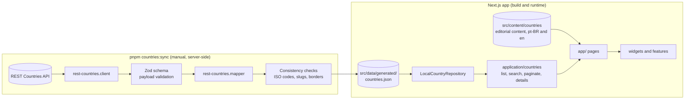

# Pocket World

Pocket World is a retro, pixel-art inspired atlas for exploring real data about the world's countries. Every country page combines structured data from open sources with hand-curated editorial notes on history, culture, cuisine, flags and sports, each one linked to its sources. The whole interface is available in Brazilian Portuguese (`pt-BR`) and English (`en`).

**Live site:** [pocket-world-six.vercel.app](https://pocket-world-six.vercel.app)

<!-- TODO: record a short demo and save it as docs/images/demo.gif -->


## Features

- Localized routes for `pt-BR` and `en` (`/pt-BR/countries/brazil`, `/en/countries/brazil`). The locale switcher keeps the current route and filters.
- Search that ignores accents and letter case, across names, capitals, regions, languages and currencies, with autocomplete.
- Filters by region and by UN membership, stored in the URL, plus pagination.
- A statically generated page for every country, with structured data, editorial sections, curiosities, sources and related countries.

## Architecture

Pocket World is a modular monolith built on the Next.js App Router. Pages are Server Components by default, and Client Components are used only where there is interaction.

External data never reaches the UI directly. A sync script fetches it on the server, validates it, maps it to the internal `Country` model and writes it to a snapshot committed to the repository. **The build reads only that snapshot and never calls external APIs.**



| Layer | Path | Responsibility |
| --- | --- | --- |
| Domain | `src/entities` | The `Country` model, summaries, utilities and the `CountryRepository` contract |
| Application | `src/application` | Use cases: listing, search, pagination, suggestions, details |
| Infrastructure | `src/infrastructure` | REST Countries client, schema and mapper, plus the local snapshot repository |
| Content | `src/content` | Editorial content for each country, in both locales, with sources |
| Data | `src/data/generated` | The versioned snapshot written by the sync script |
| UI | `src/app`, `src/widgets`, `src/features` | Routes, composed sections and interactive features |
| Shared | `src/shared` | i18n dictionaries, locale types and constants |
| Scripts | `src/scripts` | Country sync and hero animation pipeline |

## Stack

- [Next.js](https://nextjs.org/) (App Router) and React
- TypeScript (strict mode)
- Tailwind CSS
- [Zod](https://zod.dev/) for validating external payloads
- Vitest and Testing Library
- ESLint (`eslint-config-next`)
- pnpm
- Deployed on Vercel

## Getting started

Requirements:

- Node.js 22 or later
- pnpm 10 or later (the exact version is pinned in `packageManager`)
- A REST Countries API key. You need it only to refresh the snapshot, not to run or build the site.

```bash
pnpm install
pnpm dev
```

Then open <http://localhost:3000>.

### Refreshing the country snapshot

Copy `.env.example` to `.env.local` (on Windows, copy the file manually) and set the key:

```env
REST_COUNTRIES_API_KEY=...
```

The key is read only on the server. Never give it a `NEXT_PUBLIC_` prefix. Then run:

```bash
pnpm countries:sync
```

The script validates the payload, checks for duplicate ISO codes and slugs and for invalid border references, then rewrites `src/data/generated/countries.json` and prints a report. Commit the updated snapshot.

## Commands

| Command | Description |
| --- | --- |
| `pnpm dev` | Start the development server |
| `pnpm build` | Production build, using the snapshot only |
| `pnpm start` | Serve the production build |
| `pnpm lint` | Run ESLint |
| `pnpm typecheck` | Run the TypeScript compiler without emitting files |
| `pnpm test` | Run the test suite once |
| `pnpm test:watch` | Run tests in watch mode |
| `pnpm countries:sync` | Fetch, validate and save the country snapshot (requires an API key) |
| `pnpm hero:frames` | Rebuild the hero globe animation from the art sources in `assets/hero-sources/` |

Continuous integration (`.github/workflows/ci.yml`) runs lint, typecheck, tests and build on every push and pull request.

## Data sources and credits

- **Structured country data:** [REST Countries](https://restcountries.com/).
- **Flags:** images referenced by the REST Countries payload ([flagcdn.com](https://flagcdn.com/), Wikimedia Commons).
- **Editorial content:** written for this project. Each country page lists its sources, such as the CIA World Factbook, UNESCO, United Nations bodies and sports federations, with the date each one was accessed.
- **Fonts:** [Inter](https://rsms.me/inter/), [Fraunces](https://fonts.google.com/specimen/Fraunces) and [Press Start 2P](https://fonts.google.com/specimen/Press+Start+2P), all under the SIL Open Font License and served via [Fontsource](https://fontsource.org/).

## AI design decisions

> To be completed in upcoming phases: data enrichment, editorial content generation and review, and the "Ask about the country" feature.
