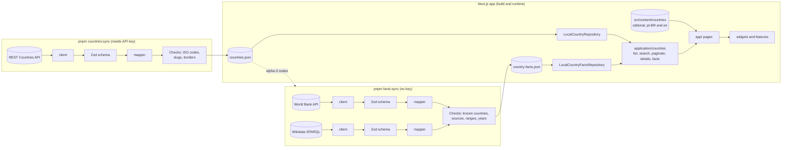

# Pocket World

Pocket World is a retro, pixel-art inspired atlas for exploring real data about the world's countries. Every country page combines structured data from open sources with hand-curated editorial notes on history, culture, cuisine, flags and sports, each one linked to its sources. The whole interface is available in Brazilian Portuguese (`pt-BR`) and English (`en`).

**Live site:** [pocket-world-six.vercel.app](https://pocket-world-six.vercel.app)

<!-- TODO: record a short demo and save it as docs/images/demo.gif -->


## Features

- Localized routes for `pt-BR` and `en` (`/pt-BR/countries/brazil`, `/en/countries/brazil`). The locale switcher keeps the current route and filters.
- Search that ignores accents and letter case, across names, capitals, regions, languages and currencies, with autocomplete.
- Filters by region and by UN membership, stored in the URL, plus pagination.
- A statically generated page for every country, with structured data, editorial sections, curiosities, sources and related countries.
- A per-country indicators panel (GDP, life expectancy, urbanization, internet use, forest area, CO₂ emissions, highest point). Each value shows its reference year and links to its source.

## Architecture

Pocket World is a modular monolith built on the Next.js App Router. Pages are Server Components by default, and Client Components are used only where there is interaction.

External data never reaches the UI directly. Sync scripts fetch it on the server, validate it, map it to internal models and write it to snapshots committed to the repository. **The build reads only those snapshots and never calls external APIs.** The two syncs are independent, so a failure in one source does not block the other.



| Layer | Path | Responsibility |
| --- | --- | --- |
| Domain | `src/entities` | The `Country` and `CountryFacts` models, their utilities and repository contracts |
| Application | `src/application` | Use cases: listing, search, pagination, suggestions, details, facts |
| Infrastructure | `src/infrastructure` | Clients, Zod schemas and mappers for REST Countries, World Bank and Wikidata, plus the local snapshot repositories |
| Content | `src/content` | Editorial content for each country, in both locales, with sources |
| Data | `src/data/generated` | Versioned snapshots written by the sync scripts |
| UI | `src/app`, `src/widgets`, `src/features` | Routes, composed sections and interactive features |
| Shared | `src/shared` | i18n dictionaries, locale types and constants |
| Scripts | `src/scripts` | Data syncs and the hero animation pipeline |

## Stack

- [Next.js](https://nextjs.org/) (App Router) and React
- TypeScript (strict mode)
- Tailwind CSS
- [Zod](https://zod.dev/) for validating external payloads
- Vitest and Testing Library
- ESLint (`eslint-config-next`)
- pnpm
- Deployed on Vercel

## Getting started

Requirements:

- Node.js 22 or later
- pnpm 10 or later (the exact version is pinned in `packageManager`)
- A REST Countries API key. You need it only to refresh the snapshot, not to run or build the site.

```bash
pnpm install
pnpm dev
```

Then open <http://localhost:3000>.

### Refreshing the country snapshot

Copy `.env.example` to `.env.local` (on Windows, copy the file manually) and set the key:

```env
REST_COUNTRIES_API_KEY=...
```

The key is read only on the server. Never give it a `NEXT_PUBLIC_` prefix. Then run:

```bash
pnpm countries:sync
```

The script validates the payload, checks for duplicate ISO codes and slugs and for invalid border references, then rewrites `src/data/generated/countries.json` and prints a report. Commit the updated snapshot.

### Refreshing the indicators snapshot

```bash
pnpm facts:sync
```

This needs no API key. It reads the country codes from `countries.json`, fetches the latest value of each World Bank indicator and each country's highest point from Wikidata, then validates and writes `src/data/generated/country-facts.json`. The report lists coverage per indicator, values older than 5 years and countries with no data. Run it after `countries:sync` whenever the country list changes.

## Commands

| Command | Description |
| --- | --- |
| `pnpm dev` | Start the development server |
| `pnpm build` | Production build, using the snapshot only |
| `pnpm start` | Serve the production build |
| `pnpm lint` | Run ESLint |
| `pnpm typecheck` | Run the TypeScript compiler without emitting files |
| `pnpm test` | Run the test suite once |
| `pnpm test:watch` | Run tests in watch mode |
| `pnpm countries:sync` | Fetch, validate and save the country snapshot (requires an API key) |
| `pnpm facts:sync` | Fetch, validate and save the indicators snapshot from World Bank and Wikidata |
| `pnpm hero:frames` | Rebuild the hero globe animation from the art sources in `assets/hero-sources/` |

Continuous integration (`.github/workflows/ci.yml`) runs lint, typecheck, tests and build on every push and pull request.

## Data sources and credits

- **Structured country data:** [REST Countries](https://restcountries.com/).
- **Indicators:** [World Bank World Development Indicators](https://data.worldbank.org/), licensed under [CC BY 4.0](https://creativecommons.org/licenses/by/4.0/).
- **Highest points and elevations:** [Wikidata](https://www.wikidata.org/), released under [CC0](https://creativecommons.org/publicdomain/zero/1.0/).
- **Flags:** images referenced by the REST Countries payload ([flagcdn.com](https://flagcdn.com/), Wikimedia Commons).
- **Editorial content:** written for this project. Each country page lists its sources, such as the CIA World Factbook, UNESCO, United Nations bodies and sports federations, with the date each one was accessed.
- **Fonts:** [Inter](https://rsms.me/inter/), [Fraunces](https://fonts.google.com/specimen/Fraunces) and [Press Start 2P](https://fonts.google.com/specimen/Press+Start+2P), all under the SIL Open Font License and served via [Fontsource](https://fontsource.org/).

## AI design decisions

### Data enrichment

- **Facts come from APIs, not from a model.** Numbers such as GDP or elevation are fetched from the World Bank and Wikidata, never written by an LLM, so every value can be traced to a dataset, a year and a license.
- **Sources were probed before they were adopted.** Wikidata's founding date (P571) was dropped because it is ambiguous: it returns 2008 for Nepal, the year it became a republic, and eleven dates for Afghanistan. Anthems and heads of state were dropped because they are contested in some countries and would go stale in a snapshot. UNESCO World Heritage counts were dropped because the UNESCO feed refuses automated access and the equivalent Wikidata query times out.
- **Some data is deliberately discarded.** World Bank values older than 10 years are dropped, because a figure like "0% internet users (1990)" misleads more than an empty field. Elevations use Wikidata's best-ranked statement, normalized to metres, because the highest raw value can be a superseded survey (Everest: 8,850 m instead of 8,848.86 m).
- **Mismatched identifiers are mapped explicitly.** Kosovo is `UNK` in the snapshot, `XKX` at the World Bank and has no alpha-3 code on Wikidata (`Q1246`). Explicit alias tables handle it, so no data is silently lost.
- **Missing data stays missing.** A country without an indicator shows "No data". Nothing is estimated or interpolated.

> Still to be documented: editorial content generation and review, and the "Ask about the country" feature.
